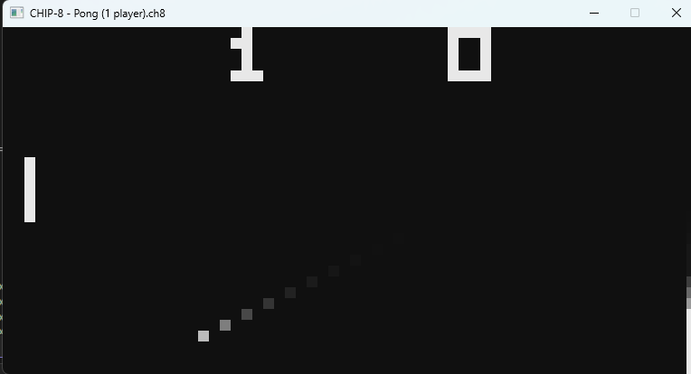
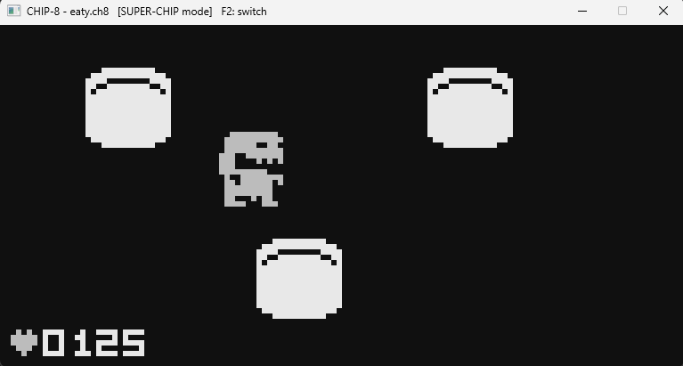
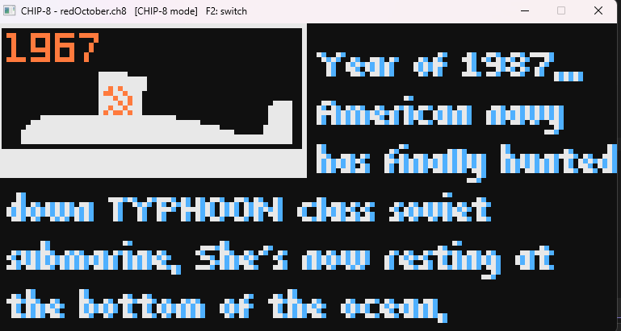

# CHIP-8 / SUPER-CHIP / XO-CHIP Emulator (C++ / SDL2)

**[▶ Play it in your browser](https://slee9817.github.io/chip8-emulator/)**

An emulator for the CHIP-8 family of virtual machines, written in C++17 with SDL2. It runs
the classic 1970s–90s CHIP-8 library (Pong, Tetris, Breakout, Space Invaders), SUPER-CHIP
games with hi-res graphics and scrolling, and modern XO-CHIP games with 4-color graphics,
64 KB of memory, and programmable sound. The same C++ code runs as a desktop app and,
compiled to WebAssembly, in any web browser.







## Features

- **Three platforms in one emulator**
  - **CHIP-8** — complete instruction set (all 35 opcodes)
  - **SUPER-CHIP** — 128×64 hi-res mode, 16×16 sprites, large 8×10 font, scrolling,
    exit, and flag storage
  - **XO-CHIP** — two bitplanes for 4-color graphics, 64 KB memory, the 4-byte
    `F000 NNNN` long-address instruction, register-range save/load, scroll up,
    and programmable audio (128-bit sample patterns with adjustable pitch)
- **Runs in the browser** — compiled to WebAssembly with Emscripten; the same C++ core
  powers both the desktop app and the web version, with a game menu built automatically
  from the bundled ROMs
- **Passes the Timendus CHIP-8 test suite** — IBM logo, Corax+ opcode test, and flags test
- **Mode switching at runtime** — **F2** cycles CHIP-8 → SUPER-CHIP → XO-CHIP; each mode
  sets the correct quirk behavior and a sensible default speed
- **Adjustable speed** — **F3 / F4** halve or double the instructions per second
- **Per-game help** — **F1** shows the current game's notes and the keypad mapping,
  read from a `.txt` file next to the ROM
- **Drag-and-drop ROM loading** (desktop) — drop any `.ch8` file on the window to switch games
- **Sound** — classic 440 Hz beep for CHIP-8 games; XO-CHIP sample-pattern playback
  generated in an SDL audio callback, with thread-safe handoff from the emulator core
- **Phosphor-style fade rendering** — pixels fade over a few frames instead of vanishing,
  which hides the flicker built into CHIP-8's XOR drawing (similar to CRT phosphor)
- **Safe memory access** — all addresses wrap within 64 KB instead of reading out of bounds

## Design

```
src/chip8.h / chip8.cpp   The virtual machine: memory, registers, stack, timers, display
                          planes, audio state, and all opcodes. No SDL dependency.
src/main.cpp              Platform layer: window, color rendering, audio playback,
                          keyboard, mode/speed controls, and the timing loop.
web/shell.html            The web page that hosts the WebAssembly build.
web/roms/                 The games bundled into the web build.
docs/                     The published web build (served by GitHub Pages) and screenshots.
```

The emulator core knows nothing about graphics, sound, or the OS. It exposes a small
interface — `step()`, `tickTimers()`, a display buffer, a key array, audio state, and a
`quirks` setting — and the platform layer drives it. That separation is what made the
browser port straightforward: the core compiled to WebAssembly unchanged, and only a few
platform details in `main.cpp` needed web-specific handling.

**Display.** The screen is always stored as a 128×64 buffer, one byte per pixel. Each
byte holds two bits — one per XO-CHIP bitplane — giving four colors. In low-res mode each
game pixel is drawn as a 2×2 block, so games see a 64×32 screen while the renderer always
works at one size. Classic CHIP-8 and SUPER-CHIP games only ever use plane 1, so they run
unchanged.

**Decoding.** Opcodes are dispatched by their top nibble in `step()`, with the larger
families (`00NN` system/display, `5XYN` compare/range, `8XYN` arithmetic, `EXNN` keys,
`FXNN` misc) handled in their own functions.

**Timing.** The CPU and the 60 Hz timers run on separate fixed-rate accumulators,
independent of frame rate, with a cap so a slow frame can't cause a runaway catch-up.

**Web build.** Emscripten's ASYNCIFY option lets the normal desktop main loop run in the
browser unchanged — `SDL_Delay` hands control back to the browser each pass. ROMs are
bundled into a virtual file system; the page reads it to build its game menu and calls an
exported C++ function, `load_rom()`, to switch games.

## Building

### Desktop

Requires CMake 3.16+, a C++17 compiler, and SDL2.

**Windows (Visual Studio + vcpkg)**
```
vcpkg install sdl2:x64-windows
vcpkg integrate install
```
Then open the folder in Visual Studio (File → Open → Folder) and build.

**macOS**
```
brew install sdl2 cmake
cmake -B build && cmake --build build
```

**Linux**
```
sudo apt install libsdl2-dev cmake g++
cmake -B build && cmake --build build
```

### Web (WebAssembly)

Requires the [Emscripten SDK](https://emscripten.org/docs/getting_started/downloads.html)
and Ninja. Emscripten provides its own SDL2, so nothing else is needed.

```
emcmake cmake -B build-web -G Ninja -DCMAKE_BUILD_TYPE=Release
cmake --build build-web
emrun build-web/index.html
```

To publish, copy `index.html`, `index.js`, `index.wasm`, and `index.data` from `build-web`
into `docs/` and push; GitHub Pages serves the site from that folder.

## Running

**In the browser:** open the [live demo](https://slee9817.github.io/chip8-emulator/), pick a
game from the menu, and click **Play**. Click the game once to enable sound.

**On the desktop:**
```
chip8 path/to/game.ch8
```
Or drag a `.ch8` file onto the window while it's running.

ROMs aren't included for the desktop build. Good sources:
- Classic CHIP-8 games: https://github.com/kripod/chip8-roms
- Newer CHIP-8, SUPER-CHIP, and XO-CHIP games: https://johnearnest.github.io/chip8Archive/
- Test suite: https://github.com/Timendus/chip8-test-suite

The web demo bundles a selection of games from the
[chip8Archive](https://johnearnest.github.io/chip8Archive/); credit to their authors.

## Controls

```
CHIP-8 keypad    Keyboard
 1 2 3 C          1 2 3 4
 4 5 6 D          Q W E R
 7 8 9 E          A S D F
 A 0 B F          Z X C V
```

| Key | Action |
|---|---|
| F1 | Show the current game's notes and controls |
| F2 | Cycle CHIP-8 / SUPER-CHIP / XO-CHIP mode |
| F3 / F4 | Halve / double emulation speed |
| Esc | Quit (desktop) |

In the browser, some F-keys may trigger browser shortcuts instead (for example, F1 or F3).

## Modes and quirks

Some instructions behave differently depending on which interpreter a game was written
for, and newer games expect to run much faster. Each mode sets both:

| | CHIP-8 | SUPER-CHIP | XO-CHIP |
|---|---|---|---|
| `8XY6`/`8XYE` shift | copies VY into VX first | shifts VX in place | copies VY into VX first |
| `FX55`/`FX65` | advance `I` | `I` unchanged | advance `I` |
| `BNNN` jump | NNN + V0 | XNN + VX | NNN + V0 |
| Sprites at screen edge | clipped | clipped | wrap around |
| Default speed | 700 instr/s | 1,800 instr/s | 30,000 instr/s |

The active mode and speed are shown in the title bar. Dropping a new ROM keeps the current
mode. In the browser, the menu switches to the right mode automatically for each game.

## Possible next steps

- On-page buttons for mode, speed, and help, so the web version doesn't rely on F-keys
- Saving SUPER-CHIP flag storage so high scores survive restarts
- Per-game settings (mode and speed) loaded automatically from the ROM's notes
- A debugger panel: registers, memory view, single-step execution

## References

- Tobias V. Langhoff, *Guide to making a CHIP-8 emulator* — https://tobiasvl.github.io/blog/write-a-chip-8-emulator/
- Cowgod's Chip-8 Technical Reference — http://devernay.free.fr/hacks/chip8/C8TECH10.HTM
- John Earnest, *XO-CHIP specification* — https://johnearnest.github.io/Octo/docs/XO-ChipSpecification.html
- Timendus CHIP-8 test suite — https://github.com/Timendus/chip8-test-suite
- Emscripten — https://emscripten.org
